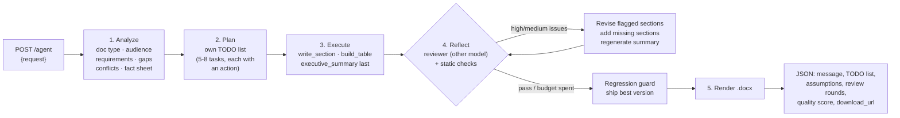

# Autonomous Document Agent

A FastAPI service that turns a plain-English request into a polished Microsoft Word document.
The agent works out what kind of document is needed, writes its own TODO list, executes each task,
reviews its own draft against the original request, fixes what is weak, and renders a styled `.docx`.

- **LLM:** Groq free tier, routed by role: `openai/gpt-oss-120b` reasons (analyze, plan, review), `qwen/qwen3.8-27b` writes, `openai/gpt-oss-20b` is the spare. Optional local Ollama fallback.
- **Stack:** FastAPI · Pydantic v2 · httpx (async) · python-docx
- **Engineering improvement:** Reflection / self-check: a cross-model quality gate, targeted revision, re-planning, and a regression guard

---

## Quick start

```bash
python3 -m venv .venv && source .venv/bin/activate
pip install -r requirements.txt
cp .env.example .env            # paste your free key from https://console.groq.com/keys
uvicorn app.main:app --port 8000
```

Open **http://localhost:8000/docs** → `POST /agent` → *Try it out* → pick the `standard` or `complex` example → *Execute*.
Watch the terminal: the agent prints its TODO list, each task as it runs, and every review round.
The JSON response contains a `download_url` for the document.

```bash
curl -s localhost:8000/agent -H 'Content-Type: application/json' \
  -d '{"request": "Write meeting minutes for our Q3 product roadmap review with 6 attendees"}' | jq .message

# or get the .docx directly
curl -s 'localhost:8000/agent?download=true' -H 'Content-Type: application/json' \
  -d '{"request": "Draft an SOP for onboarding new customer-support agents"}' -o sop.docx
```

Run both assignment test inputs and save the responses and documents into `examples/`:

```bash
python examples/run_examples.py            # or: python examples/run_examples.py complex
```

A run takes about 2–5 minutes. Groq is fast; the free tier's 8k tokens/minute per model is the bottleneck (see *Trade-offs*).

---

## How it works



| Step | What the agent decides on its own |
|---|---|
| **1. Analyze** | The document type that fits (project plan, board briefing, minutes, SOP…), title, audience, every explicit requirement, what is missing, and which requirements conflict and how to present each conflict. It never stops to ask; it makes explicit, documented assumptions. It also fixes a **fact sheet** (dates, milestones, budget split, named owners for key roles) that every section must reuse, so numbers and names stay consistent. |
| **2. Plan** | Writes its own TODO list. Each task picks an action: `write_section` (narrative), `build_table` (timelines, budgets, risk registers, RACI…), or `executive_summary`. Every requirement must map to a task (`covers`). The plan is then normalised in code: deduplicated, capped, with exactly one summary. |
| **3. Execute** | Runs the tasks one by one. **Execution order differs from document order:** the executive summary sits first in the document but runs last, from the finished sections. Each task sees the fact sheet, the conflict decisions, the outline, and digests of what is already written. A table task that comes back without a table is retried on the spot. A failing task doesn't sink the run. |
| **4. Reflect** | See below. |
| **5. Render** | python-docx: cover page, document control table (including the self-review score), contents, numbered sections, executive-summary callout, branded data tables (repeating header rows, right-aligned figures, bold totals), an *Assumptions, Decisions & Open Questions* appendix with a conflict-resolution log, and a header/footer with page X of Y. |

---

## Engineering improvement: Reflection / self-check

**What I implemented.** After the draft is written, a reviewer pass grades the whole document
**against the user's original request**, not just against itself. The loop is in `agent.py` → `_reflect` / `_revise`.

1. **Cross-model quality gate.** The reviewer is `gpt-oss-120b`, a different model family from the writer (`qwen3.8-27b`), so the agent isn't grading its own homework. It returns a 1-10 score against a fixed rubric, missing requirements, and up to 6 issues. Each issue has a severity (high / medium / low), the section that must change, and a concrete fix.
2. **Deterministic checks** catch what LLM reviewers miss: placeholder text (`[Company]`, `TBD`, `XX`), table sections without a usable table, thin sections, failed tasks.
3. **Targeted revision.** Only sections with high or medium issues are rewritten. The reviser sees the reviewer's notes and the other sections, so cross-section contradictions (a name in the risk register that isn't on the team roster) can be reconciled.
4. **Re-planning.** If an explicit requirement has no home, the agent adds a task to its own plan and executes it.
5. **Summary refresh.** If anything changed, the executive summary is regenerated so it matches the revised body.
6. **Anchored re-review.** From round 2, the reviewer first checks each previous issue (resolved or not) and only then raises new serious issues. Without this, an LLM reviewer moves the goalposts every round and scores aren't comparable. Every round reports `previous_issues_resolved`, e.g. `6/6`.
7. **Regression guard.**
   - A revision that drops a table, adds placeholders or loses half its content is rejected.
   - Every reviewed version is snapshotted; if a later round scores clearly worse, the best version is shipped. LLM-judge scores wobble by about a point, so a 1-point dip alone doesn't undo real fixes.
8. **Bounded.** A draft passes with no high or medium issues (or 9/10+ with no high issues); otherwise up to 3 review rounds.

**Why I chose it.** In a document agent, the most common failure isn't a crash. It's a document that looks
complete but quietly drops a requirement, contradicts itself (a $48k budget in one section, $60k in another),
or leaves placeholders. You only find those after sending it. Reflection targets output quality, which is
what the user actually judges, and it makes that quality measurable.

**How it improves the agent: results from the runs in [`examples/`](examples/).**

| Test | Review scores | What the reviewer caught and the agent fixed |
|---|---|---|
| Standard | **5/10 → 9/10**, 6/6 issues resolved | A milestone whose start date was after its end date, inconsistent milestone dates, team members not in the fact sheet, an executive summary quoting the wrong dates |
| Complex | **9/10** first pass | Passed straight away: the conflict decisions from the analysis step were applied consistently |

Other development runs of the complex request (5/10 → 9/10 twice) showed the same mechanism on harder failures: arithmetic errors in a budget table
("28% cheaper" that was actually 72%), a hiring budget double-counted across two sections, an empty table,
and a summary stating "€200k approved" when the request said it was only possible. One run
regressed after revision (8 → 8 → 7) and the guard shipped the best version.

**Supporting robustness (not the headline improvement).** Every LLM call is validated against a Pydantic
schema, and invalid JSON is fed back to the model to repair. A 429 never fails a call by itself: the model is
put on cooldown (Groq's `retry-after`) and the call moves to whichever model frees up first, within a time
budget. Dead endpoints are dropped.

---

## Test inputs

| | Request |
|---|---|
| **Standard** | *Create a project plan for migrating our customer support team (25 agents) from Zendesk to Freshdesk over 8 weeks. Include scope, timeline with milestones, team roles and responsibilities, budget, risks with mitigations, and success metrics.* |
| **Complex** | *Our CEO wants something for next week's board meeting about rolling out our AI customer-service chatbot across Europe. Keep it to one page but make sure it covers everything: GDPR and the EU AI Act, costs, timeline, hiring, and how we compare with competitors. Budget is around €50k, though finance mentioned €200k might be approved. Sales wants launch before Christmas, but legal says nothing goes live before Q2 next year. We haven't decided which countries go first.* |

The complex request is deliberately ambiguous ("something"), conflicting (one page vs. everything,
€50k vs. €200k, Christmas vs. Q2) and incomplete (no countries, no company or competitor names). In the
saved run the agent:

- chose a **Board Briefing** with 6 sections, front-loading a recommendation;
- resolved each conflict with a stated rationale:
  - **Budget:** €50k as a lean MVP baseline vs. €200k full scale, as an explicit board decision.
  - **Timeline:** legal's Q2 2027 date becomes the hard stop for public launch, with an internal soft launch in Q4 2026 for sales.
  - **Countries:** phased rollout starting with Germany and France.
- listed the open questions for the board (company and competitor names, hiring budget, vendor stack) instead of stalling.

All of this lands in the document's *Assumptions, Decisions & Open Questions* appendix and in the `analysis`
block of the response.

---

## API

`POST /agent`

```json
{ "request": "natural-language description of the document (10-4000 chars)" }
```

Query param `download=true` returns the `.docx` file instead of JSON.

Response (abridged; full examples in `examples/*_response.json`):

```json
{
  "status": "success",
  "message": "Generated a 7-section Project Plan \"…\" (~1555 words) for … Self-review score 5/10 → 9/10 after revising 2 section(s).",
  "document": { "filename": "…docx", "download_url": "http://localhost:8000/documents/…docx", "sections": ["…"], "word_count": 1555 },
  "key_points": ["…"],
  "analysis": { "document_type": "Project Plan", "explicit_requirements": [], "conflicts": [], "assumptions": [], "missing_information": [], "key_facts": [] },
  "quality_score": 9,
  "plan_rationale": "…",
  "todo": [{ "id": "T3", "title": "Timeline with Milestones", "action": "build_table", "status": "revised", "duration_s": 2.4 }],
  "reflection": [
    { "round": 1, "score": 5, "verdict": "revise", "issues": [{ "section_id": "T3", "severity": "high", "problem": "…", "fix": "…" }], "revised_sections": ["…"] },
    { "round": 2, "score": 9, "verdict": "pass", "previous_issues_resolved": "6/6", "shipped": true }
  ],
  "usage": { "llm_calls": 36, "prompt_tokens": 0, "completion_tokens": 0, "retries": 0, "fallbacks": 0, "models_used": {} },
  "elapsed_s": 209.2
}
```

Errors: `422` for invalid or out-of-scope requests (guardrail), `502` if every LLM endpoint fails.
Other endpoints: `GET /documents/{filename}`, `GET /health` (shows the active model chain).

---

## Project layout

```
app/
  main.py           FastAPI app, endpoints, Swagger examples
  agent.py          Orchestrator: analyze → plan → execute → reflect/revise → render
  prompts.py        Prompt templates per module (all return strict JSON)
  schemas.py        Pydantic models: API contract + lenient schemas for messy LLM output
  llm.py            OpenAI-compatible client: JSON mode, self-repair, role routing, rate-limit-aware fallback
  docx_renderer.py  python-docx styling and layout
  config.py         Settings from .env
examples/           Test-input runner, saved responses and documents
outputs/            Generated documents
```

## Configuration

| Variable | Default | Purpose |
|---|---|---|
| `GROQ_API_KEY` | (required) | Groq free-tier key |
| `GROQ_REASONING_MODEL` | `openai/gpt-oss-120b` | Analyze, plan, review |
| `GROQ_WRITER_MODEL` | `qwen/qwen3.8-27b` | Write and revise sections |
| `GROQ_FALLBACK_MODELS` | `openai/gpt-oss-20b` | Extra capacity / fallback |
| `OLLAMA_MODEL` | (unset) | Optional local last-resort model |
| `AGENT_REVIEW_ROUNDS` | `3` | Max review passes |
| `AGENT_QUALITY_THRESHOLD` | `8` | Score a clean draft needs to pass |
| `LLM_MAX_RATE_LIMIT_WAIT` | `2` | Seconds to wait for the preferred model before using another |

## Trade-offs and next steps

- **Free-tier throughput.** A run uses about 20–45k tokens. At 8k tokens/minute per model, routing across three models keeps a run to roughly 2–5 minutes (longer if runs are back to back); on a paid tier the same pipeline finishes in well under a minute. Independent sections could also be written in parallel once rate limits allow.
- **Coherence over speed.** Sections are written sequentially so each sees what came before.
- **LLM judges are noisy.** Scores vary run to run. The anchored re-review, severity rules and regression guard exist because of this, but scores are a signal, not ground truth.
- **Next:** conversation memory (`session_id`) so a user can say *"make the budget section shorter"* and re-run only that task; streaming progress over SSE; brand templates per company.
