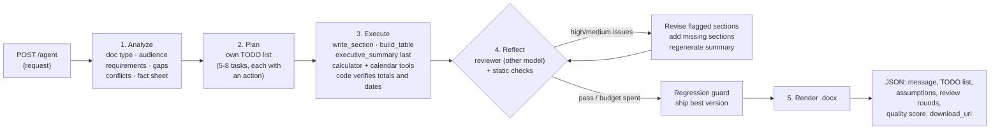

# Autonomous Document Agent

A FastAPI service that turns a plain-English request into a polished Microsoft Word document.
The agent works out what kind of document is needed, writes its own TODO list, executes each task,
reviews its own draft against the original request, fixes what is weak, and renders a styled `.docx`.

- **LLM:** Groq free tier, routed by role: `openai/gpt-oss-120b` reasons (analyze, plan, review), `qwen/qwen3.8-27b` writes, `openai/gpt-oss-20b` is the spare. Optional local Ollama fallback.
- **Stack:** FastAPI · Pydantic v2 · httpx (async) · python-docx
- **Engineering improvement:** Reflection / self-check: a cross-model quality gate, targeted revision, re-planning, and a regression guard
- **Second improvement:** Tool calling: the model uses a deterministic calculator and calendar while it writes, and code verifies every table total and date afterwards ([details](#second-improvement-tool-calling-for-exact-numbers-and-dates))

---

## Quick start

```bash
python3 -m venv .venv && source .venv/bin/activate
pip install -r requirements.txt
cp .env.example .env            # paste your free key from https://console.groq.com/keys
uvicorn app.main:app --port 8000
```

Open **http://localhost:8000/docs** → `POST /agent` → *Try it out* → pick the `standard` or `complex` example → *Execute*.
Watch the terminal: the agent prints its TODO list, each task as it runs (with any time spent waiting on free-tier rate limits), its calculator/calendar calls, and every review round.
The JSON response contains a `download_url` for the document.

```bash
curl -s localhost:8000/agent -H 'Content-Type: application/json' \
  -d '{"request": "Write meeting minutes for our Q3 product roadmap review with 6 attendees"}' | jq .message

# or get the .docx directly
curl -s 'localhost:8000/agent?download=true' -H 'Content-Type: application/json' \
  -d '{"request": "Draft an SOP for onboarding new customer-support agents"}' -o sop.docx
```

Run the offline tests (no API key or network needed):

```bash
pip install -r requirements-dev.txt && pytest
```

Run both assignment test inputs and save the responses and documents into `examples/`:

```bash
python examples/run_examples.py            # or: python examples/run_examples.py complex
```

A run takes about 2–5 minutes. Groq is fast; the free tier's 8k tokens/minute per model is the bottleneck (see *Trade-offs*).

---

## How it works



| Step | What the agent decides on its own |
|---|---|
| **1. Analyze** | The document type that fits (project plan, board briefing, minutes, SOP…), title, audience, every explicit requirement, what is missing, and which requirements conflict and how to present each conflict. It never stops to ask; it makes explicit, documented assumptions. It also fixes a **fact sheet** (dates, milestones, budget split, named owners for key roles) that every section must reuse, so numbers and names stay consistent. It computes the fact sheet with the calculator and calendar tools, and code then checks its dates, because every section copies from it. |
| **2. Plan** | Writes its own TODO list. Each task picks an action: `write_section` (narrative), `build_table` (timelines, budgets, risk registers, RACI…), or `executive_summary`. Every requirement must map to a task (`covers`). The plan is then normalised in code: deduplicated, capped, with exactly one summary. |
| **3. Execute** | Runs the tasks one by one. **Execution order differs from document order:** the executive summary sits first in the document but runs last, from the finished sections. Each task sees the fact sheet, the conflict decisions, the outline, and digests of what is already written. Sections about money, schedules or metrics get the calculator and calendar tools, and every section is verified by code after it is written (see *Second improvement*). A table task that comes back without a table is retried on the spot. A failing task doesn't sink the run. |
| **4. Reflect** | See below. |
| **5. Render** | python-docx: cover page, document control table (including the self-review score), contents, numbered sections, executive-summary callout, branded data tables (repeating header rows, right-aligned figures, bold totals), an *Assumptions, Decisions & Open Questions* appendix with a conflict-resolution log, and a header/footer with page X of Y. |

---

## Engineering improvement: Reflection / self-check

**What I implemented.** After the draft is written, a reviewer pass grades the whole document
**against the user's original request**, not just against itself. The loop is in `agent.py` → `_reflect` / `_revise`.

1. **Cross-model quality gate.** The reviewer is `gpt-oss-120b`, a different model family from the writer (`qwen3.8-27b`), so the agent isn't grading its own homework. It returns a 1-10 score against a fixed rubric, missing requirements, and up to 6 issues. Each issue has a severity (high / medium / low), the section that must change, and a concrete fix.
2. **Deterministic checks** catch what LLM reviewers miss: placeholder text (`[Company]`, `TBD`, `XX`), table sections without a usable table, thin sections, failed tasks.
3. **Targeted revision.** Only sections with high or medium issues are rewritten. The reviser sees the reviewer's notes and the other sections, so cross-section contradictions (a name in the risk register that isn't on the team roster) can be reconciled.
4. **Re-planning.** If an explicit requirement has no home, the agent adds a task to its own plan and executes it.
5. **Summary refresh.** If anything changed, the executive summary is regenerated so it matches the revised body.
6. **Anchored re-review.** From round 2, the reviewer first checks each previous issue (resolved or not) and only then raises new serious issues. Without this, an LLM reviewer moves the goalposts every round and scores aren't comparable. Every round reports `previous_issues_resolved`, e.g. `6/6`.
7. **Regression guard.**
   - A revision or regeneration that drops a table, empties a section, adds placeholders or loses half its content is rejected. This was seen live: a regenerated summary came back as valid JSON with 0 words. Empty or table-less first drafts are retried on the spot.
   - Every reviewed version is snapshotted. If a later round scores clearly worse, or ties but has more high-severity issues, the best version is shipped. LLM-judge scores wobble by about a point, so a 1-point dip alone doesn't undo real fixes.
8. **Bounded.** A draft passes with no high or medium issues (or 9/10+ with no high issues); otherwise up to 3 review rounds.

**Why I chose it.** In a document agent, the most common failure isn't a crash. It's a document that looks
complete but quietly drops a requirement, contradicts itself (a $48k budget in one section, $60k in another),
or leaves placeholders. You only find those after sending it. Reflection targets output quality, which is
what the user actually judges, and it makes that quality measurable.

**How it improves the agent: results from the runs in [`examples/`](examples/)** (generated with tools on).

| Test | Review scores | What the reviewer caught and the agent fixed |
|---|---|---|
| Standard | **8/10 → 7/10 → 9/10**, 2/2 then 2/2 issues resolved | A risk mitigation adding a $5,000 contingency and a 1-week buffer that the fixed 8-week plan didn't allow, a satisfaction survey scheduled after the project ended, then an extra $3,000 missing from the $120,000 budget and a support window running past the end date |
| Complex | **8/10 → 5/10 → 9/10**, 1/1 resolved in the final round | A resource plan too thin to be useful (73 words, caught by the code checks), then an executive summary too long for a one-page board brief. The dip in round 2 is the anchored re-review flagging a new high-severity problem, not a regression |

Earlier development runs of the complex request (5/10 → 9/10 twice) showed the same mechanism on harder failures: arithmetic errors in a budget table
("28% cheaper" that was actually 72%), a hiring budget double-counted across two sections, an empty table,
and a summary stating "€200k approved" when the request said it was only possible. One run
regressed after revision (8 → 8 → 7) and the guard shipped the best version.

**Supporting robustness (not the headline improvement).** Every LLM call is validated against a Pydantic
schema, and invalid JSON is fed back to the model to repair. A 429 never fails a call by itself: the model is
put on cooldown (Groq's `retry-after`) and the call moves to whichever model frees up first, within a time
budget. Dead endpoints are dropped.

---

## Second improvement: tool calling for exact numbers and dates

**What I implemented.** Reflection *catches* mistakes after writing. Tools *prevent* the most common ones:
the model can't do reliable arithmetic or calendar maths, so it doesn't have to.

1. **Deterministic tools** (`app/tools.py`), exposed through native function calling (OpenAI-compatible `tools`):

   | Tool | Use |
   |---|---|
   | `calculate(expression)` | Exact arithmetic on a whitelisted AST: numbers, `+ - * / ** %`, `round/sum/min/max/abs`. `eval` is never used. |
   | `percentage(part, whole)` | Shares, e.g. a cost line as % of the budget |
   | `percent_change(from, to)` | Every "X% cheaper/higher" claim, phrased for the writer: "50000 is 72.2% lower than 180000" |
   | `project_calendar(start, weeks)` | Week-by-week dates with weekdays, so week numbers and dates agree |
   | `date_add`, `days_between` | Derived dates, business days, durations |

   The client (`llm.py`) runs the loop: the model requests tools (several per turn), the client executes them and
   returns the results, and the model writes its JSON. Groq can't combine JSON mode with tools, so after at most 3
   tool turns the final turn drops the tools, forces JSON mode and adds a nudge. Tool errors go back to the model
   as data, never as crashes. Tools are offered only where they pay off: the fact sheet, sections about
   money, schedules or metrics, the executive summary, and revisions of arithmetic or date issues.

2. **Code verification after every write** (`app/verify.py`), because models skip tools or misuse them:
   - **Auto-fixed (unambiguous):** plain `Total` / `Subtotal` / `Grand total` rows in money or quantity columns are recomputed in the cell's own format (`€45,000`, `45k`, `$45,000.00`); `% of total` shares are recomputed from the amounts; weekday names that don't match their date ("Wednesday 21 Dec 2026" becomes Monday).
   - **Flagged to the reviser (ambiguous):** qualified totals such as "Total Committed" may cover a *subset* of rows, so they are never rewritten. They are flagged only if they match neither the rows above, the rows sharing their qualifier, nor all rows. Date ranges that end before they start are flagged too, since code can't know which end is wrong.
   - The **fact sheet** is checked first, because every section copies from it.
   - The reviewer is told that table arithmetic has been verified, so if the text contradicts a table, the text is wrong.

**Why.** In the reflection runs, most of the reviewer's catches were arithmetic and dates: a budget that summed
to €190k against a stated €180k, an ROI of 77.7% that is really 74.05%, a "28% cheaper" that was really 72%,
milestones ending before they start. Each of those costs a review round to find and a revision to fix,
and the reviewer only catches some of them.

**Before/after evidence.** [`examples/eval_tools.py`](examples/eval_tools.py) runs each request with tools off (the
previous agent) and on, and stops after the first review to measure first-draft quality. Code counts the
errors in each draft in both modes; with tools off it only measures. A third, arithmetic-heavy request
(a retail business case with a 12-month P&L, break-even and ROI) was added because the assignment inputs are light on
numbers. Raw results: [`examples/tool_eval.json`](examples/tool_eval.json).

| Request | Tools | Math/date errors in first draft | Errors reaching the reviewer | Reviewer-flagged math/date issues | First-review score | Tool calls | Tokens | Time |
|---|---|---|---|---|---|---|---|---|
| standard | off | 0 | 0 | 0 | 8 | 0 | 20k | 46 s |
| standard | on | 0 | 0 | 0 | 9 | 7 | 39k | 59 s |
| complex | off | 1 | 1 | 1 (budget summed to €190k vs €180k) | 5 | 0 | 19k | 30 s |
| complex | on | 2 ¹ | 0 | 1 (a deadline on a public holiday) | 5 | 33 | 83k | 342 s |
| numbers | off | 2 | 2 | 2 (P&L total mismatch; ROI 77.7% vs 74.05%) | 5 | 0 | 20k | 24 s |
| numbers | on ² | 0 | 0 | — | — | 21 | 80k | 260 s |

¹ Both were the false correction described below; the redesigned verifier turns that run into 1 flagged issue and no edits.
² Earlier build, not in `tool_eval.json`: the first draft was measured, but the review was cut off at its token limit (since fixed with a larger review budget and an automatic retry with more tokens). Groq's daily token cap stopped a re-run that day.

**What the evidence says, honestly.**
- **The deterministic result is clear:** with tools on, no arithmetic or date error reached the reviewer in any run; with tools off, 1–2 did on the requests with real numbers. On the arithmetic-heavy request the writer made 21 tool calls and its first draft had 0 errors, against 2 without tools.
- **Scores don't show a reliable gain.** One run per cell, and LLM-judge scores swing by up to 4 points between runs of the same request. The reviewer still finds things code can't check, like a deadline on a public holiday.
- **The cost is real:** 2–4× the tokens, because each tool turn re-sends the prompt. On Groq's free tier (8k tokens/minute per model, plus a daily cap) that means slower runs. Topic-based gating limits it, and `AGENT_TOOLS=false` turns the feature off.

**Found while building it.** Each of these became a fix and a test:
- **The model mis-added *inside* its own tool call.** gpt-oss-20b passed `(180000 - 55000)` when the items summed to 50,000. Hence the rule "pass raw numbers, never your own subtotals", and code verification as a backstop.
- **A wrong fact sheet made the reviewer punish correct sections.** The analysis wrote "Wednesday 21 Dec 2026" (a Monday). Code fixed the sections, then the reviewer flagged them for contradicting the fact sheet; that run scored 6, against 8 with tools off. The fact sheet is now verified before anything uses it.
- **The verifier corrupted a correct-looking table.** It rewrote "Total Committed: 50,000" as the sum of *all* rows (200,000). That's why the auto-fix vs. flag split exists, with this exact table as a regression test. The model's real mistake there was that the committed rows summed to 20,000, and that is now what gets flagged.
- **Live example in the saved complex run:** the analysis wrote "Fri 15 Dec 2026" (a Tuesday) into the fact sheet; code fixed it before any section copied it.
- **Groq-specific failure modes:** "Tool choice is none, but model called a tool" and "Parsing failed" 400s are now retryable bad outputs rather than dead endpoints.
- **Quota exhaustion produced an empty document.** A live run with the daily token cap nearly spent returned HTTP 200 with a 0-section document, because every task failed instantly. Now the client raises a dedicated rate-limit error, the agent aborts the first draft, and the API returns `503` with a `Retry-After` header and a plain message ("try again in about 10 minutes").

**Tests.** `pytest` runs 26 offline tests in under a second: tools, verifier, the tool loop against a mocked
Groq API (tool turns, budget nudge, 400 recovery, 429s), and a full agent run with a scripted fake LLM that plants
the real-world errors above and checks each one is fixed or sent to the reviser.

---

## Test inputs

| | Request |
|---|---|
| **Standard** | *Create a project plan for migrating our customer support team (25 agents) from Zendesk to Freshdesk over 8 weeks. Include scope, timeline with milestones, team roles and responsibilities, budget, risks with mitigations, and success metrics.* |
| **Complex** | *Our CEO wants something for next week's board meeting about rolling out our AI customer-service chatbot across Europe. Keep it to one page but make sure it covers everything: GDPR and the EU AI Act, costs, timeline, hiring, and how we compare with competitors. Budget is around €50k, though finance mentioned €200k might be approved. Sales wants launch before Christmas, but legal says nothing goes live before Q2 next year. We haven't decided which countries go first.* |

The complex request is deliberately ambiguous ("something"), conflicting (one page vs. everything,
€50k vs. €200k, Christmas vs. Q2) and incomplete (no countries, no company or competitor names). In the
saved run the agent:

- chose a **Board Briefing** with 6 sections, opening with "Executive Summary & Recommendation";
- resolved each conflict with a stated rationale:
  - **Budget:** €50,000 as the committed pilot baseline, and €200,000 as the maximum the board may approve for the full rollout.
  - **Timeline:** two scenarios. Sales' pre-Christmas 2026 target is flagged as non-compliant, and a compliant Q2 launch on 30 May 2027 is recommended.
  - **Countries:** Germany, France and Spain as a provisional first trio.
- listed the open questions for the board (priority countries, cost breakdown, hiring numbers, competitor names, how to split the budget) instead of stalling.

All of this lands in the document's *Assumptions, Decisions & Open Questions* appendix and in the `analysis`
block of the response.

---

## API

`POST /agent`

```json
{ "request": "natural-language description of the document (10-4000 chars)" }
```

Query param `download=true` returns the `.docx` file instead of JSON.

Response (abridged; full examples in `examples/*_response.json`):

```json
{
  "status": "success",
  "message": "Generated a 7-section Project Plan \"…\" (~1695 words) for … Self-review score 8/10 → 7/10 → 9/10 after revising 6 section(s).",
  "document": { "filename": "…docx", "download_url": "http://localhost:8000/documents/…docx", "sections": ["…"], "word_count": 1695 },
  "key_points": ["…"],
  "analysis": { "document_type": "Project Plan", "explicit_requirements": [], "conflicts": [], "assumptions": [], "missing_information": [], "key_facts": [] },
  "quality_score": 9,
  "plan_rationale": "…",
  "todo": [{ "id": "T3", "title": "Timeline with Milestones", "action": "build_table", "status": "revised", "duration_s": 2.4 }],
  "reflection": [
    { "round": 1, "score": 8, "verdict": "revise", "issues": [{ "section_id": "T7", "severity": "medium", "category": "dates", "problem": "…", "fix": "…" }], "revised_sections": ["…"] },
    { "round": 3, "score": 9, "verdict": "pass", "previous_issues_resolved": "2/2", "shipped": true }
  ],
  "checks": { "tools_enabled": true, "tool_calls": { "calculate": 9, "project_calendar": 5, "date_add": 4, "percentage": 2 }, "first_draft_errors": 0,
              "fact_sheet_errors": 1, "totals_checked": 0, "corrections": ["[fact sheet] weekday: 'Fri 15 Dec 2026' -> Tue (15 Dec 2026 is a Tuesday)"] },
  "usage": { "llm_calls": 74, "prompt_tokens": 0, "completion_tokens": 0, "retries": 0, "fallbacks": 0, "models_used": {}, "rate_limit_wait_s": 38.5 },
  "elapsed_s": 244.9
}
```

Errors: `422` for invalid or out-of-scope requests (guardrail), `503` with a `Retry-After` header when the free-tier quota is exhausted, `502` if every LLM endpoint fails for another reason.
Other endpoints: `GET /documents/{filename}`, `GET /health` (shows the active model chain).

---

## Project layout

```
app/
  main.py           FastAPI app, endpoints, Swagger examples
  agent.py          Orchestrator: analyze → plan → execute → reflect/revise → render
  prompts.py        Prompt templates per module (all return strict JSON)
  schemas.py        Pydantic models: API contract + lenient schemas for messy LLM output
  llm.py            OpenAI-compatible client: JSON mode, tool-calling loop, self-repair, role routing, rate-limit-aware fallback
  tools.py          Deterministic tools: calculator, percentages, calendar
  verify.py         Code verification of table totals, shares, weekdays and date ranges
  docx_renderer.py  python-docx styling and layout
  config.py         Settings from .env
tests/              Offline tests (no network): tools, verifier, tool loop, full pipeline with a fake LLM
examples/           Test-input runner, saved responses and documents, tools before/after evaluation
outputs/            Generated documents
```

## Configuration

| Variable | Default | Purpose |
|---|---|---|
| `GROQ_API_KEY` | (required) | Groq free-tier key |
| `GROQ_REASONING_MODEL` | `openai/gpt-oss-120b` | Analyze, plan, review |
| `GROQ_WRITER_MODEL` | `qwen/qwen3.8-27b` | Write and revise sections |
| `GROQ_FALLBACK_MODELS` | `openai/gpt-oss-20b` | Extra capacity / fallback |
| `OLLAMA_MODEL` | (unset) | Optional local last-resort model |
| `AGENT_REVIEW_ROUNDS` | `3` | Max review passes |
| `AGENT_QUALITY_THRESHOLD` | `8` | Score a clean draft needs to pass |
| `LLM_MAX_RATE_LIMIT_WAIT` | `2` | Seconds to wait for the preferred model before using another |
| `AGENT_TOOLS` | `true` | Calculator/calendar tool calling and table/date verification |
| `LOG_LEVEL` | `INFO` | `DEBUG` also shows every rate-limit wait and model switch; at `INFO` each task line just notes the total wait |

## Trade-offs and next steps

- **Tools cost tokens.** Tool turns re-send the prompt, so tools on uses 2–4× the tokens. Gating by topic limits it; a stronger next step is caching the shared prompt prefix or computing the fact sheet's calendar once in code.
- **Free-tier throughput.** A run uses about 20–45k tokens without tools. At 8k tokens/minute per model, routing across three models keeps a run to roughly 2–5 minutes (longer if runs are back to back); on a paid tier the same pipeline finishes in well under a minute. Independent sections could also be written in parallel once rate limits allow.
- **Coherence over speed.** Sections are written sequentially so each sees what came before.
- **LLM judges are noisy.** Scores vary run to run. The anchored re-review, severity rules and regression guard exist because of this, but scores are a signal, not ground truth.
- **Next:** conversation memory (`session_id`) so a user can say *"make the budget section shorter"* and re-run only that task; streaming progress over SSE; brand templates per company.
